# Architecture

Pulse described with the [C4 model](https://c4model.com/): context, containers,
components. Level 4 (code) is the code itself; in its place are the data model, the
three flows worth tracing end to end, and the two state machines.

The diagrams are Mermaid, so they live in Git, are reviewed in the same PR as the
code they describe, and render on GitHub without a build step. Decisions and their
alternatives are in [`docs/adr/`](docs/adr/).

Box notation: **name**, [type: technology], what it does. Arrow labels: what
travels, [protocol].

## Level 1: system context

Who uses Pulse and what it talks to.

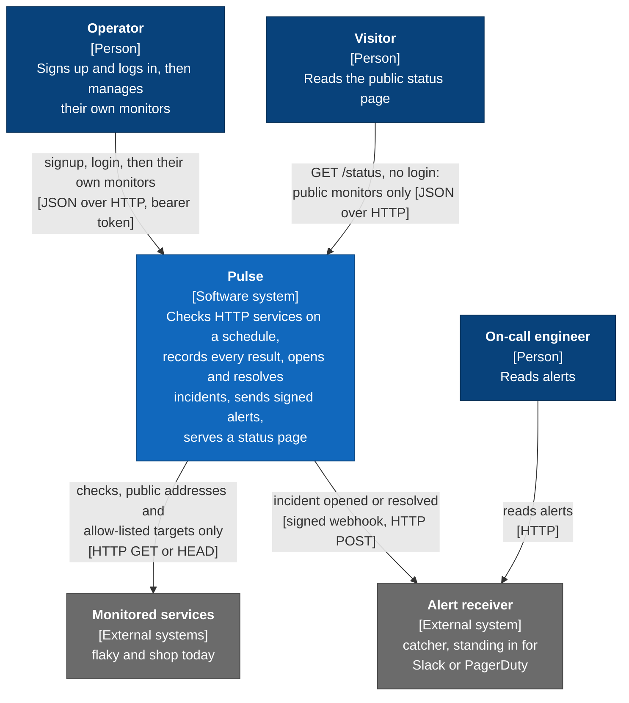

Pulse only reaches services over HTTP. It never sees a target's database or cache:
it learns about them through the target's own deep health check.

Trust boundaries: an operator is whoever holds a valid token, and sees only their
own monitors. A monitor's URL is untrusted input that Pulse itself will request,
so the host is resolved and judged before every check ([SECURITY.md](SECURITY.md)).

## Level 2: containers

What runs. `api`, `worker` and `beat` are the same image and codebase started with
three different commands.

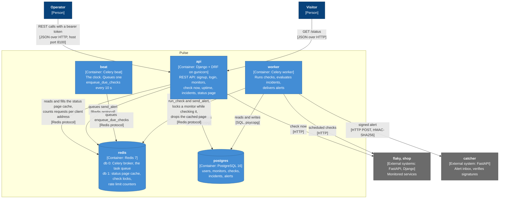

| Container  | Scales how                                   | State                         |
| ---------- | -------------------------------------------- | ----------------------------- |
| `api`      | more replicas behind a load balancer         | none                          |
| `worker`   | `--scale worker=N`                           | none                          |
| `beat`     | exactly one, two would queue everything twice | schedule file in `/tmp`       |
| `redis`    | single instance                              | queued tasks, locks, the cached page and rate limit counters; no named volume, all of it can be lost |
| `postgres` | single instance                              | the system of record (volume `pgdata`) |

`api` can queue a task as well as `worker`: "check now" runs the same service code,
and if that check opens an incident, the alert is queued from the request.

`api` holds no session: who is calling is in the token sent with each request, so
any replica can answer any request. Only `api` checks tokens and counts requests.
`worker` acts for the system and for every owner.

### Deployment: Compose projects and networks

`flaky` and `catcher` are services of the `pulse` Compose project for convenience,
but Pulse treats them as outsiders. `shop` is a separate project, like a service
another team operates.

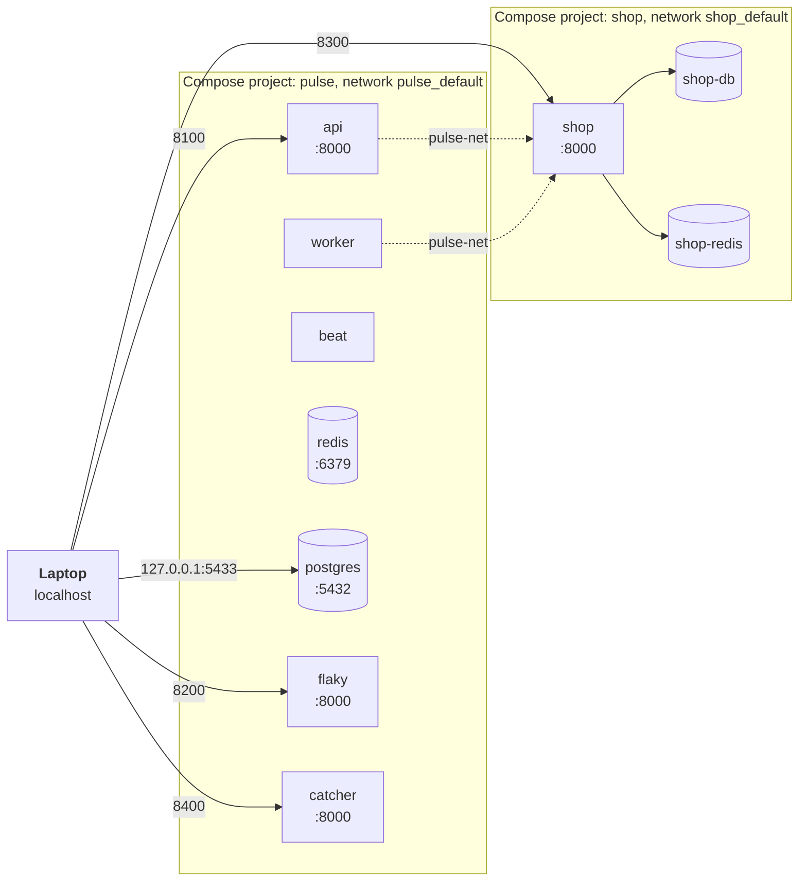

| Network         | Members                                                   | Purpose                                 |
| --------------- | --------------------------------------------------------- | --------------------------------------- |
| `pulse_default` | api, worker, beat, redis, postgres, flaky, catcher        | Pulse's own traffic                     |
| `pulse-net`     | api, worker, shop                                         | the only path from Pulse to shop        |
| `shop_default`  | shop, shop-db, shop-redis                                 | shop's private dependencies             |

`shop-db` and `shop-redis` are unreachable from Pulse by design.

## Level 3: components

Inside the Django codebase that `api` and `worker` both run. Arrows point from
caller to callee. An HTTP request enters at the top left and passes DRF's gate
(who is calling, may they, how often) before any view runs. A Celery task enters
at the top right. Both meet in `services`.

```mermaid
flowchart TB
    http(["HTTP request"])
    task(["Celery task message"])

    subgraph gate ["Before every view: DRF defaults from settings"]
        authn["<b>accounts/authentication.py</b><br/>[DRF authentication class]<br/>Bearer token to request.user, or 401"]
        throttling["<b>core/throttling.py</b><br/>[DRF throttles]<br/>Per client address: 429 with Retry-After"]
    end

    subgraph entry ["Entry points: no business rules"]
        accviews["<b>accounts/views.py, serializers.py</b><br/>[PublicAPIView]<br/>POST /signup, POST /login"]
        views["<b>monitors/views.py</b><br/>[DRF APIView]<br/>Parse, call a service with the caller<br/>as owner, shape the response"]
        serializers["<b>monitors/serializers.py</b><br/>[DRF serializers]<br/>Validate input, shape output"]
        handler["<b>core/exception_handler.py</b><br/>Domain errors to 401, 404 and 409"]
        tasks["<b>monitors/tasks.py</b><br/>[Celery tasks]<br/>enqueue_due_checks, run_check, send_alert"]
    end

    subgraph domain ["Domain: no HTTP in, no Celery in"]
        accservices["<b>accounts/services.py</b><br/>signup, login"]
        tokens["<b>accounts/tokens.py</b><br/>[PyJWT]<br/>issue and verify a signed token"]
        ratelimit["<b>core/ratelimit.py</b><br/>[Strategy]<br/>fixed_window: count one request"]
        services["<b>monitors/services.py</b><br/>Business rules: CRUD scoped to an owner,<br/>claim_due_monitors, check_monitor,<br/>evaluate_incidents, uptime, open and resolve"]
        ssrf["<b>monitors/ssrf.py</b><br/>safe_address: resolve the host, judge<br/>every address, return the one to call"]
        statuspage["<b>monitors/status_page.py</b><br/>Build the public page in four queries<br/>from public monitors, cache it, invalidate it"]
        uptime["<b>monitors/uptime.py</b><br/>The uptime and p95 aggregates"]
        incidents["<b>monitors/incidents.py</b><br/>[Pure function]<br/>decide: open, resolve or nothing"]
        alerting["<b>monitors/alerting.py</b><br/>Record an alert, sign it, deliver it,<br/>retry policy"]
        checks["<b>monitors/checks.py</b><br/>probe: one HTTP call with a deadline,<br/>classified into a CheckResult"]
    end

    subgraph infra ["Infrastructure"]
        accmodels["<b>accounts/models.py</b><br/>[Django ORM, argon2]<br/>User: email and password hash"]
        models["<b>monitors/models.py</b><br/>[Django ORM]<br/>Monitor, Check, Incident, Alert<br/>and their constraints"]
        clients["<b>monitors/clients.py</b><br/>[httpx, redis-py]<br/>probe_client, webhook_client,<br/>redis_client"]
        locks["<b>monitors/locks.py</b><br/>[Redis SET NX EX, Lua]<br/>acquire, release if still ours"]
        cache["<b>Django cache framework</b><br/>[Redis backend]"]
        db["<b>core/db.py</b><br/>PercentileCont, violated_constraint"]
    end

    http --> authn
    http --> throttling
    authn --> tokens
    authn --> accmodels
    throttling --> ratelimit
    ratelimit --> cache
    http --> accviews
    accviews --> accservices
    accservices --> tokens
    accservices --> accmodels
    accservices -. "raises EmailTaken,<br/>InvalidCredentials" .-> handler
    http --> views
    views --> serializers
    serializers --> ssrf
    views --> services
    views --> statuspage
    services -. "raises MonitorNotFound,<br/>MonitorNameTaken, IncidentAlreadyOpen" .-> handler
    task --> tasks
    tasks --> services
    tasks --> alerting
    tasks --> locks
    services --> checks
    services --> incidents
    services --> alerting
    services --> models
    services --> db
    services --> uptime
    services -. "invalidate after commit" .-> statuspage
    statuspage --> uptime
    statuspage --> models
    statuspage --> cache
    locks --> clients
    alerting --> models
    alerting -. "queues send_alert<br/>after commit" .-> tasks
    checks --> ssrf
    checks --> clients
    alerting --> clients
```

| Rule                                                        | Kept by                                              |
| ----------------------------------------------------------- | ---------------------------------------------------- |
| Views and tasks hold no business rules                      | both call `services`; "check now" and the scheduler share `check_monitor` |
| `services` knows nothing about HTTP status codes            | it raises domain errors; `core/exception_handler.py` maps them |
| `incidents.decide` has no I/O                               | it takes a list of booleans and returns an enum      |
| Rules that two requests could break at once live in Postgres | named constraints; `violated_constraint` reads which one fired |
| Every endpoint needs a token unless it says otherwise       | `IsAuthenticated` is DRF's default; only a `PublicAPIView` subclass is open, and a test holds the list |
| A request reaches a monitor only as its owner               | `services.get_monitor(pk, owner)`: the owner is a required argument and part of the query |
| A check connects only to an address that was judged         | `probe` calls `ssrf.safe_address` and requests the address it returns, never the name |
| The rate limit algorithm can change without touching views  | throttles are handed a `Limiter` function; `fixed_window` is the only one |

`core/` holds what any app could use (errors, pagination, the exception handler,
database helpers, startup checks of settings, the public view base class, rate
limiting). `accounts/` is users and tokens. `config/` is the project: settings,
URLs, the Celery app, typed environment readers.

## Data model

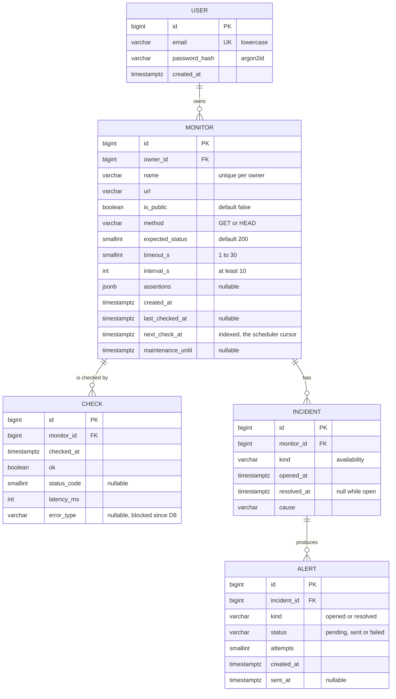

| Table       | Index or constraint                                                          | Serves                                         |
| ----------- | ---------------------------------------------------------------------------- | ---------------------------------------------- |
| `users`     | `uq_user_email` unique `(email)`                                             | signing up twice is a 409, decided by Postgres |
| `users`     | `ck_user_email_lowercase` check `email = lower(email)`                       | one account per address whatever its case      |
| `monitors`  | `uq_monitor_owner_name` unique `(owner_id, name)`                            | duplicate name is a 409 for that owner only; also the index behind "my monitors" |
| `monitors`  | index on `(next_check_at)`                                                   | "which monitors are due" every 10 s            |
| `checks`    | `checks_monitor_checked_idx` on `(monitor_id, checked_at)`                   | the uptime query, "last N checks", the status page |
| `incidents` | `uq_one_open_incident_per_kind` unique `(monitor_id, kind)` where `resolved_at IS NULL` | at most one open incident per monitor and kind |
| `alerts`    | `uq_alert_incident_kind` unique `(incident_id, kind)`                        | one alert per incident event, however often it is queued |

Deleting a user cascades to their monitors. Deleting a monitor cascades to its
checks, incidents and alerts. `checks` is append-only and is the only table that
grows without bound.

## Flows

### Login, then a request with the token

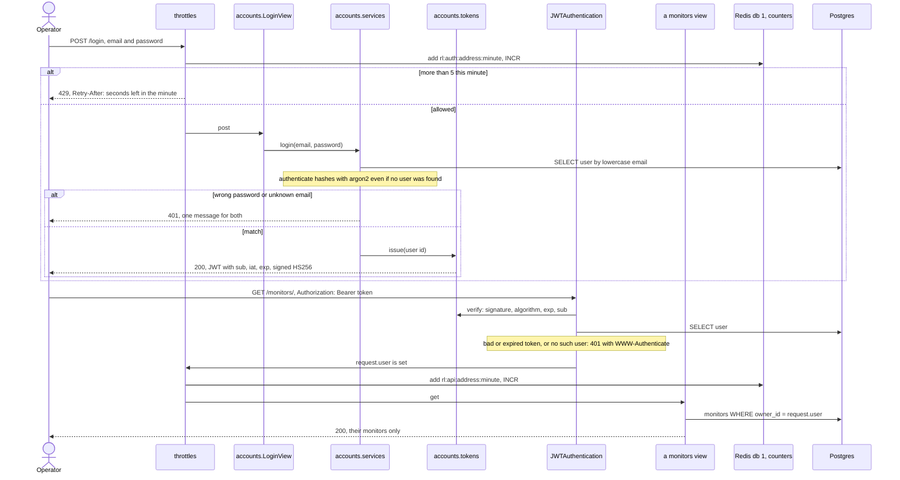

DRF runs authentication, then permissions, then throttles, then the view. `/login`
has no authentication step, so its throttle is the first thing that runs.

### Check now: `POST /monitors/<id>/check/`

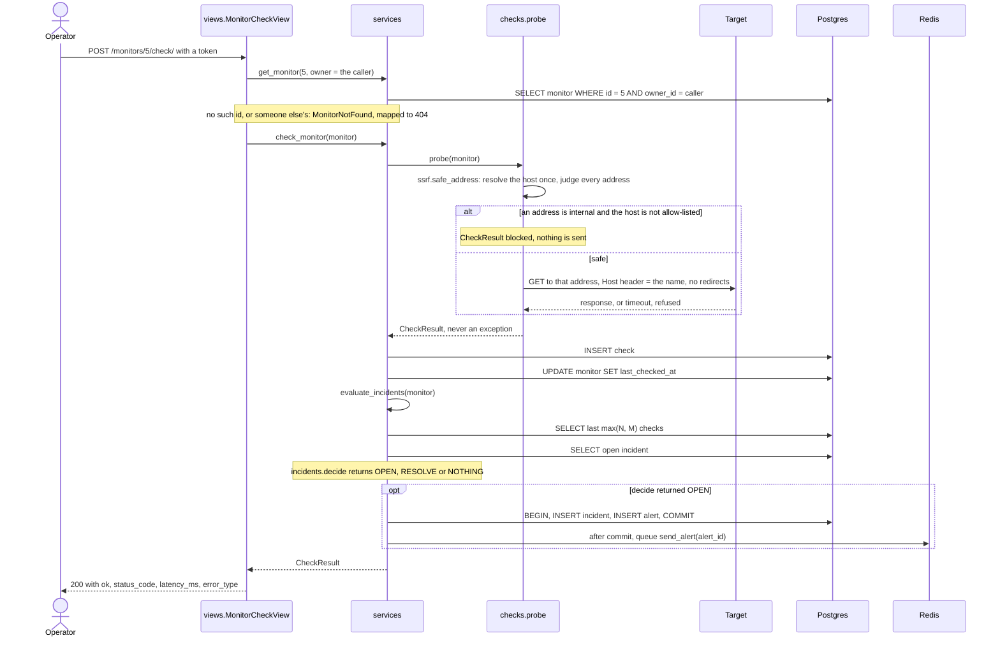

The answer is 200 whatever the target did: a target that is down is the result,
not an error in Pulse.

### Scheduled check

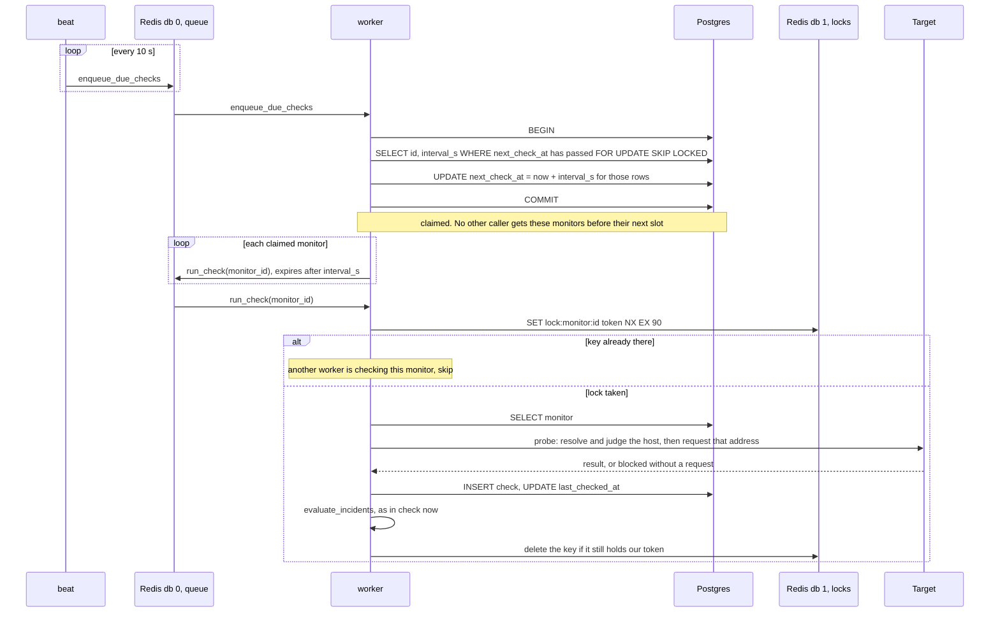

From `services.check_monitor` onward this is the same code path as "check now".
Task arguments are ids, never objects: they cross Redis as JSON and the row is
loaded fresh when the task runs. Celery kills a `run_check` after 75 s, so a lock
(90 s) cannot expire under a check that is still running.

### Alert delivery

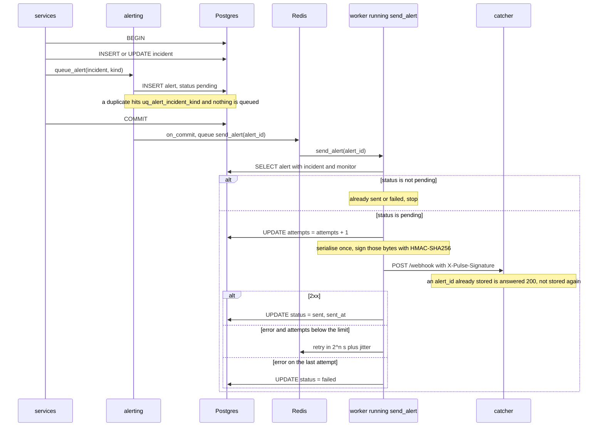

Delivery is at-least-once. Every attempt carries the same `alert_id` in the signed
body, and the catcher stores each id once.

### Status page: `GET /status`

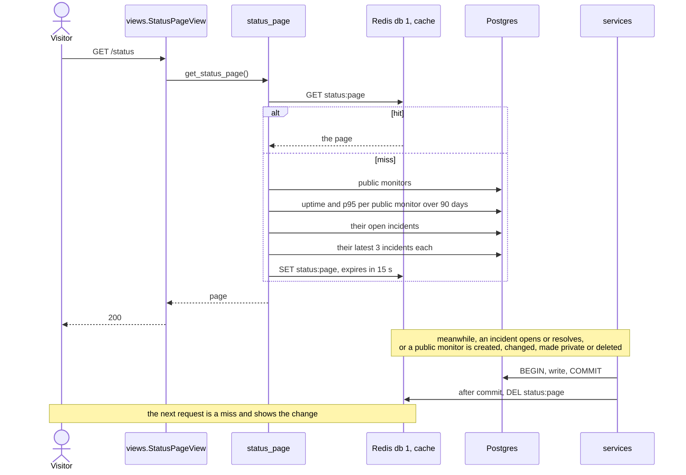

The page is the one place monitors of every owner are read together, and only
those with `is_public` set.

## State machines

### Incident, per monitor and kind

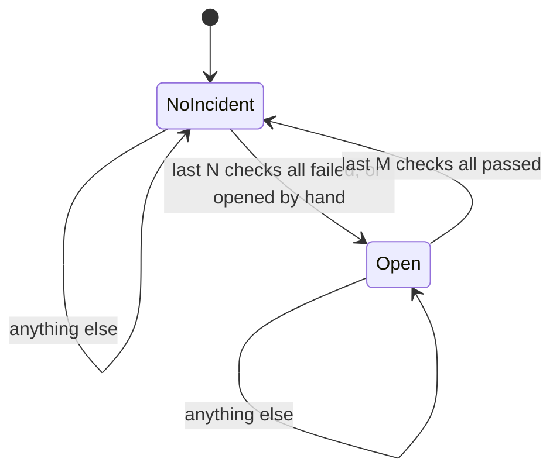

N is `PULSE_FAIL_THRESHOLD` (3), M is `PULSE_OK_THRESHOLD` (2). The state is not a
column: a monitor is in `Open` when it has an incident row with `resolved_at IS
NULL`. During a maintenance window no transition happens.

### Alert

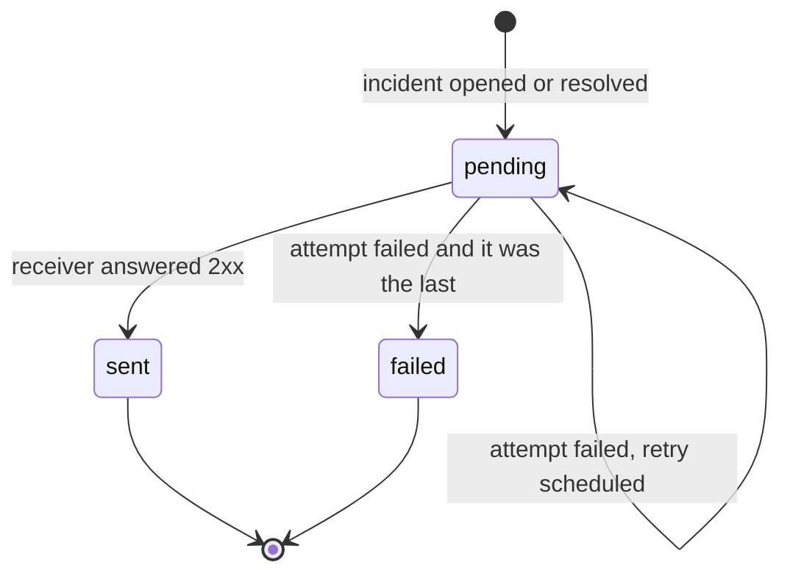

## Decisions

| ADR | Decision |
| --- | -------- |
| [0001](docs/adr/0001-shared-http-clients.md) | One shared HTTP client per process, keep-alive off for checks |
| [0002](docs/adr/0002-layering.md) | Thin views and tasks over a service layer, the ORM as the repository |
| [0003](docs/adr/0003-database-enforced-rules.md) | Rules that can race are enforced by Postgres constraints |
| [0004](docs/adr/0004-incident-detection.md) | Incident detection is a pure function over the last checks |
| [0005](docs/adr/0005-scheduling.md) | Celery with Redis, one beat tick that queues what is due |
| [0006](docs/adr/0006-alert-delivery.md) | Alerts: row first, queue on commit, at-least-once delivery |
| [0007](docs/adr/0007-targets-as-separate-services.md) | Targets and the receiver are separate services |
| [0008](docs/adr/0008-one-check-per-interval.md) | One check per interval: claim in Postgres, lock in Redis |
| [0009](docs/adr/0009-status-page-cache.md) | The status page is cached by key and dropped when an incident changes |
| [0010](docs/adr/0010-check-deadline.md) | A check has a total deadline, not only a timeout per wait |
| [0011](docs/adr/0011-keyset-pagination.md) | Keyset pagination next to limit/offset |
| [0012](docs/adr/0012-latest-check-without-n-plus-one.md) | A monitor's latest check comes from the same query as the monitor |
| [0013](docs/adr/0013-authentication.md) | Email accounts, a signed token per request, and no Django admin |
| [0014](docs/adr/0014-ownership.md) | A monitor is looked up together with its owner |
| [0015](docs/adr/0015-ssrf-guard.md) | Checks resolve the host themselves and connect only to an address they judged |
| [0016](docs/adr/0016-rate-limiting.md) | A fixed-window rate limit, counted in Redis, applied by DRF throttles |

## Known limits

| Limit | Effect | Where it is addressed |
| ----- | ------ | --------------------- |
| A check slower than its interval makes the lock skip the next slot | such a monitor is checked every second or third interval | not scheduled: reject `timeout_s` above `interval_s` |
| The check deadline is only looked at between reads | a target that trickles its response headers runs to the 75 s kill, which records no check | not scheduled: an async client under one deadline |
| A worker that crashes mid-check leaves its lock for up to 90 s | that monitor is not checked until the lock expires | accepted: the price of a TTL that never expires under a live check |
| A crash between claiming a monitor and queueing its check | that interval's check is lost, the next one runs | accepted: at most once per interval |
| Every request that misses the status cache rebuilds the page | a burst right after an invalidation runs the heavy query many times at once | not scheduled: a lock around the rebuild, or rebuild in a worker |
| `checks` is never pruned | the 90-day queries slow as the table grows | not scheduled: retention or daily roll-ups |
| An alert whose `send_alert` message is lost stays `pending` | broker down at commit, or a worker killed mid-task | not scheduled: a periodic sweep of old pending alerts |
| One Redis for queue, locks, cache and rate limit counters | losing it stops checks, alerts and the status page, and the API answers 500 | separate instances in production |
| A token cannot be revoked before it expires | a stolen token works for up to an hour | accepted: ADR 0013 |
| Checks do not follow redirects | a URL that redirects records the 3xx | not scheduled: judge every hop, ADR 0015 |
| The rate limit is a fixed window per client address | twice the limit across a minute boundary; many addresses get many counts | accepted: ADR 0016. A proxy in front is the next layer |
| No web UI for the data | rows are read with `manage.py shell` or `psql` | accepted: ADR 0013 says how to bring the admin back |
| One `requirements.txt` | test and lint tools ship in the production image | D9 |
